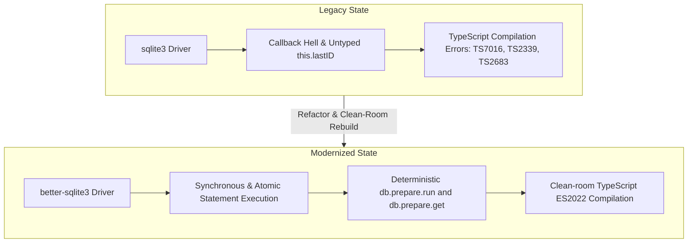
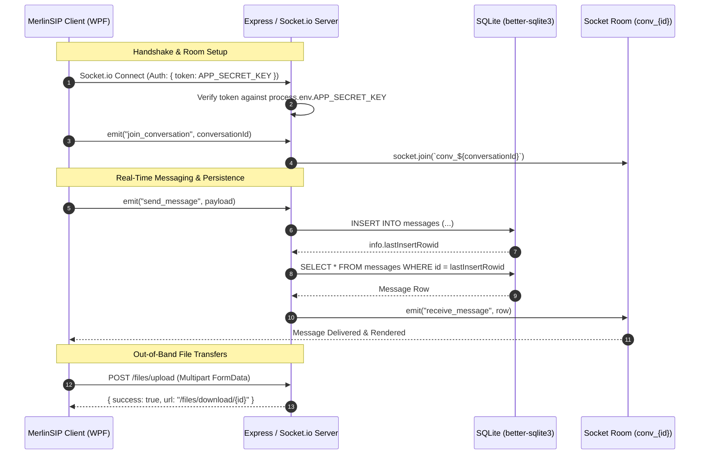

# Comprehensive Technical & Architectural Blueprint: MerlinSIP VoIP Backend

This reference encapsulates the evolutionary design, runtime topology, protocol specifications, and operational environment for the **MerlinSIP VoIP Chat & Data Signaling Backend** (`voip-chat-backend`).

---

## 1. System Genesis & Evolutionary Milestones



- **Problem Statement**: Under asynchronous `sqlite3`, concurrent message persistence suffered from untyped context bindings (`this.lastID`), race conditions during burst messaging, and TypeScript strict mode failures.
- **Resolution**: Migrated to `better-sqlite3`. SQLite queries execute synchronously and atomically within the Node.js event loop, guaranteeing that `lastInsertRowid` retrieval and subsequent room broadcast occur in the same synchronous frame.
- **Production Artifact**: Clean build via `tsc` targeting `CommonJS` / `ES2022`, deployed in `./dist/server.js`.

---

## 2. Infrastructure & Hosting Environment

| Layer | Specification | Details |
|---|---|---|
| **Host OS** | Debian Linux | Minimal server footprint with standard POSIX toolchain |
| **Process Manager** | PM2 | Fork mode tied to `systemd` (`pm2-root.service`) for automatic crash recovery and boot persistence |
| **Runtime** | Node.js (v18+) | LTS runtime executing compiled JavaScript from `dist/` |
| **Target Build** | TypeScript 5.4+ | `es2022` target, `commonjs` module, `strict: true` |
| **Domain & Edge** | Reverse Proxy | Terminating TLS at `https://handler.chriskendall.media` routing WebSocket & HTTP |

---

## 3. Architecture & Protocol Alignment with MerlinSIP Client



### Protocol & Event Contract

#### A. Handshake Authentication
- **Transport**: Socket.io Handshake Auth
- **Client Transmission**: `{ auth: { token: "<APP_SECRET_KEY>" } }`
- **Verification**: Exact string match with `process.env.APP_SECRET_KEY`. Non-matching clients receive connection error `Invalid app token`.

#### B. Socket Events

| Event Name | Direction | Payload Structure | Behavior |
|---|---|---|---|
| `join_conversation` | Client → Server | `conversationId: string` | Joins socket to room `conv_${conversationId}` |
| `send_message` | Client → Server | `{ conversationId, senderId, messageType, content, fileName?, fileSize? }` | Synchronously stores row in SQLite and triggers room broadcast |
| `receive_message` | Server → Room | `{ id, conversation_id, sender_id, message_type, content, file_name, file_size, timestamp }` | Dispatched to all room members; client verifies receipt |
| `error` | Server → Client | `{ message: string }` | Dispatched when DB insertion or payload validation fails |

#### C. HTTP REST Endpoints

1. **`GET /api/health`**
   - Probe target for client latency and uptime monitoring (`ChatConnectorService.ProbeServerAsync`).
   - Expected Response: `200 OK` (`{ status: "ok", timestamp: "..." }`).

2. **`POST /files/upload`**
   - Multipart form-data handling (`file`, `conversationId`, `senderId`).
   - Expected Response:
     ```json
     {
       "success": true,
       "url": "/files/uploads/<stored-filename>",
       "fileName": "document.pdf",
       "fileSize": 1048576
     }
     ```

3. **`GET /files/:filename`**
   - Serves uploaded assets with stream caching and proper MIME headers.

---

## 4. Database Schema Specification

```sql
CREATE TABLE IF NOT EXISTS messages (
  id INTEGER PRIMARY KEY AUTOINCREMENT,
  conversation_id TEXT NOT NULL,
  sender_id TEXT NOT NULL,
  message_type TEXT DEFAULT 'text',
  content TEXT NOT NULL,
  file_name TEXT,
  file_size INTEGER,
  timestamp DATETIME DEFAULT CURRENT_TIMESTAMP
);

CREATE INDEX IF NOT EXISTS idx_messages_conversation ON messages (conversation_id, id DESC);
```

---

## 5. Directory Structure & Key Files

```
voip-chat-backend/
├── dist/                     # Compiled JavaScript (Target of PM2)
├── node_modules/
├── src/
│   ├── routes/
│   │   └── files.ts          # Multipart upload and file retrieval handlers
│   ├── database.ts           # better-sqlite3 connection and migration management
│   └── server.ts             # Express + Socket.io bootstrap and signaling logic
├── .env.example
├── database.sqlite           # Persistent SQLite database file
├── package.json
├── package-lock.json
└── tsconfig.json
```
